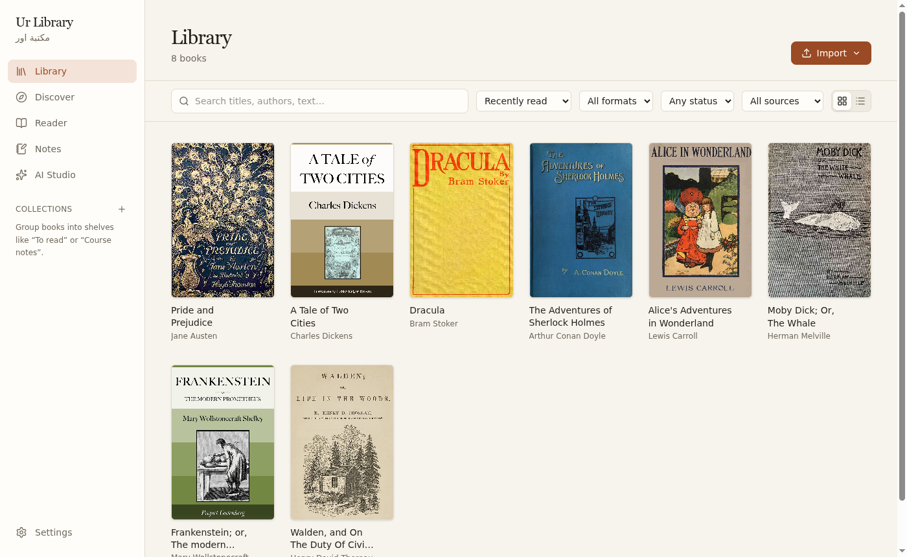
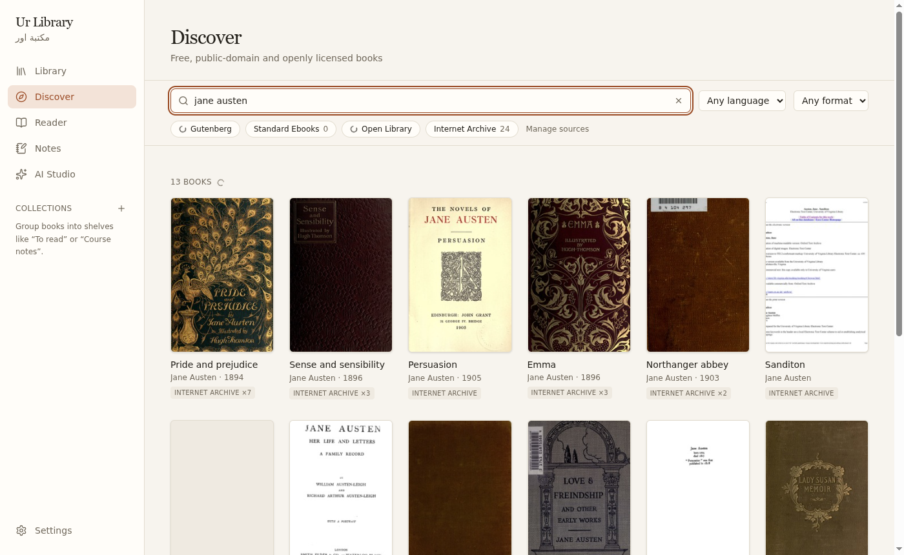
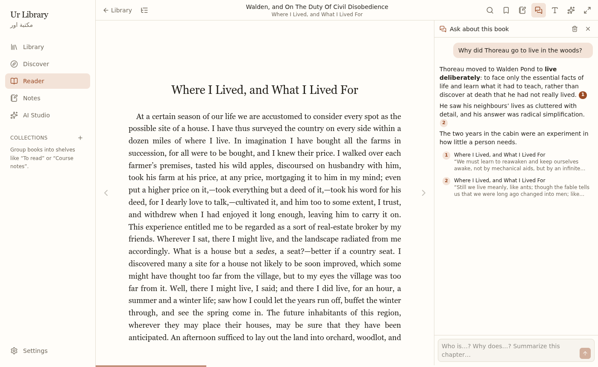
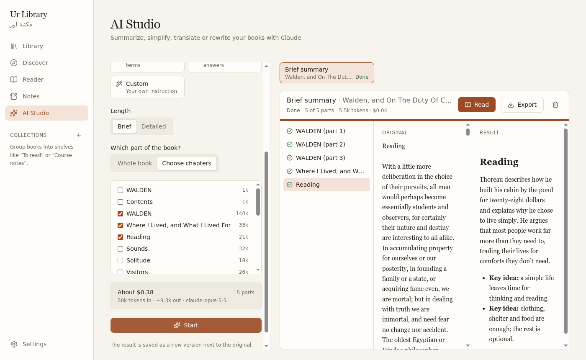

# Ur Library · مكتبة اور

A desktop app for reading. Find and download free public-domain books, import your own PDF, EPUB,
Word, text and Markdown files, read them with highlights and notes, and use Claude (with your own
Anthropic API key) to summarize, simplify, translate or rewrite a book, or ask questions about it
with answers that link to the passages they come from.



| Discover free books | Ask about a book |
| --- | --- |
|  |  |



## Install

Download from the [releases page](https://github.com/49mg/UrLibrary/releases/latest):

- **Linux:** `ur-library-<version>.AppImage` (any distribution; updates itself) or
  `ur-library_<version>_amd64.deb` (Debian/Ubuntu; update by installing the newer `.deb`).
  For the AppImage: `chmod +x ur-library-*.AppImage` and run it.
- **Windows / macOS:** installers can be built from this repository (`npm run build:win`,
  `npm run build:mac` on those systems); they aren't code-signed yet, so the OS will warn on first
  launch.

The AI features need an Anthropic API key. Add it in **Settings → AI**. It's stored encrypted with
your system keyring and only ever sent to Anthropic. Everything else works without one.

**Updates:** the AppImage (and the Windows/macOS installers) check GitHub Releases in the
background, download new versions quietly and install them when you restart. This can be turned off
in Settings → Updates.

**Backups:** Settings → Backup saves one zip with all books, highlights, notes, chats and AI
versions; "Restore from backup" puts it back (the current library is kept aside, not deleted). The
API key isn't included in backups.

## Where the books come from

Discover only offers books that are free to download and read:

| Source | What's offered | Terms |
| --- | --- | --- |
| [Project Gutenberg](https://www.gutenberg.org) | 75,000+ public-domain books | Public domain in the USA. Check your country's copyright law before downloading if you live elsewhere. Gutenberg's [terms of use](https://www.gutenberg.org/policy/terms_of_use.html) ask automated tools to be gentle: the app uses the official OPDS catalog, caches results and downloads one file per request. |
| [Standard Ebooks](https://standardebooks.org) | Carefully produced public-domain ebooks | Their releases are dedicated to the public domain (CC0). Only the public new-releases feed is used; the full catalog requires their paid membership. |
| [Open Library](https://openlibrary.org) / [Internet Archive](https://archive.org) | Public-domain scans and openly licensed books | Only items with an open license or published in 1930 or earlier are shown. Lending-library (borrowable, in-copyright) books are excluded. |
| [arXiv](https://arxiv.org) (off by default) | Research papers | Each paper keeps its author's license; arXiv's license allows reading and personal copies. |

Books you import yourself stay on your computer. When you use an AI feature, the text involved is
sent to Anthropic's API under your own account and [their terms](https://www.anthropic.com/legal).

## Development

```bash
npm install
npm run dev            # start the app with hot reload
npm run lint && npm run typecheck

npm run build:linux    # AppImage + .deb in dist/
```

## Architecture

```
src/
  shared/      IPC contract (channel names + types) and default settings, used by all processes
  main/        Electron main process — all file, network, database and AI work
    db/        SQLite via node:sqlite (built into Electron's Node), migrations, repositories
    ipc/       zod-validated handlers; every response is an { ok, data | error } envelope
    import/    import pipeline: hashing/dedup, per-format text extractors (PDF, EPUB, DOCX, TXT/MD),
               chunking for search and AI, OCR (tesseract.js) for scanned PDFs
    workers/   utility-process entry that runs extraction/OCR off the main thread
    services/  FileStore (library folder + book:// protocol), SecretStore (safeStorage), JobQueue
  preload/     exposes a typed, minimal `window.api` via contextBridge
  renderer/    React UI (Tailwind v4, Zustand, React Router)
    reader/    PDF (pdf.js viewer), EPUB (epub.js) and HTML (DOCX/TXT/MD) readers behind one
               ReaderHandle interface, plus the shared chrome (TOC, search, display, focus mode)
```

**Security defaults:** `contextIsolation`, `sandbox`, no `nodeIntegration`, strict CSP, IPC only
from our own renderer, all arguments validated, the Anthropic API key encrypted with Electron
`safeStorage` and never sent to the renderer.

**Import pipeline:** files are hashed (duplicates are detected by content), copied into the
library, then a utility process extracts metadata, a cover and the text, which is split into
~2,000-character chunks, indexed with SQLite FTS5 and saved as `text/chunks.json` for AI features.
Scanned PDFs are flagged and can be OCR'd; language data is downloaded once on first use.

**Reader locations:** positions are strings shared by search, progress and (later) notes:
`page:12` (PDF), `cfi:epubcfi(...)` / `href:<file>` (EPUB), `heading:3` (DOCX/MD, the n-th
heading), `section:2` (TXT), `scroll:0.42` (saved scroll position in HTML views). Untrusted book
content is sandboxed: EPUB pages render in script-less iframes, DOCX/MD/TXT HTML is sanitized
with DOMPurify.

**Discover (free books):** searches Project Gutenberg (official OPDS), Open Library, the Internet
Archive and arXiv in parallel, plus Standard Ebooks' public new-releases feed. Only public-domain or
openly licensed items are offered: Internet Archive results must carry an open license or be
published in 1930 or earlier, and lending-library items are excluded. Download URLs are resolved in
the main process (never taken from the UI), must be https on the source's own host, are size-limited,
and are checked by their first bytes before import. Catalog responses are cached in SQLite.

**AI Studio:** uses Claude (`claude-opus-5-5`, adaptive thinking, effort from Settings) through the
user's own Anthropic API key, stored with Electron `safeStorage` (on Linux the app asks for the
libsecret keyring explicitly, since Chromium only auto-detects it on GNOME/KDE). Books are split
into ~15k-token parts at paragraph boundaries; each part streams to the UI and is saved in SQLite
as it finishes, so jobs can pause/resume and survive restarts. Server-side refusal fallback
(`fallbacks: "default"`) is enabled. Results become Markdown "versions" next to the original (never
modified), readable and annotatable in the reader, exportable to PDF, Word or Markdown. Book text
is passed to the model as tagged content, never as instructions. Tests use a fake Anthropic API,
so they never spend money.

**Chat with a book:** the reader's chat panel asks Claude about the open book using the API's
citations feature: passages are sent as blocks of a document, and the API returns exactly which
blocks each sentence came from, so every answer links to real passages (click a number to jump
there). Books up to ~200k tokens are sent whole with prompt caching, so follow-ups mostly read from
cache; longer books get the most relevant passages per question from the FTS5 index (plus where
the reader is). Conversations are stored per book and replayed exactly as the API returned them
(thinking blocks included); if the book's text changes, a fresh conversation starts.

**Highlights & notes:** stored in SQLite, never written into the original file. Each one keeps a
format-specific anchor (PDF page + rectangles as page fractions, EPUB CFI, or a text quote with
surrounding context for DOCX/MD/TXT that is re-found if the text shifts — see
`src/shared/anchoring.ts`). Notes export to Markdown, and PDF highlights export as standard PDF
Highlight annotations in a copy of the file.

**Data location:** `<userData>/library.db` (SQLite) and `<userData>/library/<bookId>/…` for files
(`~/.config/ur-library` on Linux). Book files reach the UI through the `book://<bookId>/<path>`
protocol, which refuses paths outside the book's folder. Only one instance runs at a time; a second
launch focuses the open window.

**Backup format:** a zip with `manifest.json`, a consistent database snapshot (`VACUUM INTO`) and
the `library/` folder, written as a stream so large libraries never need to fit in memory. A restore
is checked first (manifest, schema version, `PRAGMA quick_check`, no paths outside the folder), then
applied at the next start, before the database is opened.

**Packaging:** electron-builder. Renderer libraries are bundled by Vite and kept out of
`node_modules` in the package; native canvas binaries and Tesseract's worker files are unpacked
from the asar archive. Updates use electron-updater with GitHub Releases; a `.deb` install doesn't
self-update.
